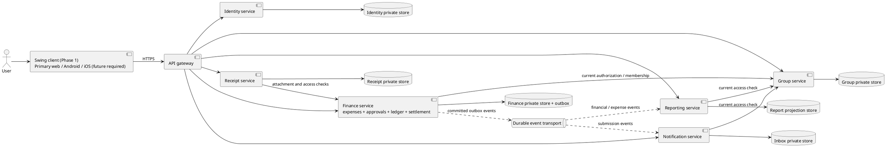

# SplitSmart Alternative Architecture — CIS 285 Lab 7

**Date:** 2026-11-04  
**Style:** Modular service-oriented architecture (SOA), organized by business capability  
**Status:** Retained comparison alternative; not selected. The project owner approved Architecture 1, the modular monolith, under [ADR-001](architecture-decision.md) on 2026-11-04. The SOA proposal below remains intact as design comparison material.

This proposal reviews the [existing Spec Kit plan](plan.md), [original customer requirements](../../UserRequirement.md), [feature specification](spec.md), and [constitution](../../.specify/memory/constitution.md). It preserves every customer capability and confirmed decision DEC-001–DEC-008. PLAN-001 still governs delivery: Phase 1 is a Java 21 Swing desktop MVP built with Maven; the primary web product and Android and iOS apps remain mandatory future deliveries. No requirement is satisfied merely by this design, and the original plan remains unchanged.

## Architectural Difference

The existing plan is a layered modular monolith: desktop requests enter one server, pass through application/domain boundaries, and reach one shared transactional database. Its main modules represent technical responsibilities such as domain, application, contracts, server and desktop.

This alternative uses six coarse-grained business services: Identity, Group, Finance, Receipt, Notification and Reporting. Each service owns its business behavior and private data, can run in a separate process, and communicates through versioned APIs or durable events. Services cannot query or update another service's tables. A service can use internal classes and presentation-independent business logic, but system decomposition follows business capabilities rather than one global sequence of layers.

For example, the Notification service consumes an expense-submission event and stores its own inbox entries. It neither calls a shared notification repository inside the Finance process nor participates in the Finance database transaction. Reporting builds its own read model instead of joining tables in a common application database. These changes introduce independent deployment and explicit distributed failure handling, making the proposal structurally different from renaming the existing modules.

## Components, Responsibilities and Data Ownership

| Component | Responsibilities | Owned data / boundary |
| --- | --- | --- |
| Client applications | Swing first; future primary web, Android and iOS clients. Collect input, display status, invoke APIs, and keep financial rules on the server. Swing performs network work off the event dispatch thread. | UI state and temporary caches only; no authoritative balances or database credentials |
| API gateway | Public entry point, route requests, authenticate sessions through Identity, apply request limits and correlation IDs, and combine selected responses for screens. | Routing/configuration only; no expense rules, ledger or business database |
| Identity service | Register users, verify email/password credentials, manage sessions, recover passwords and provide minimal authorized profile information. | Account credentials, session/recovery token hashes; private SMTP adapter |
| Group service | Create/manage groups, invite members, enforce owner/manager roles, retain membership history and supply current authorization decisions. | Groups, invitations, roles, membership history and membership versions |
| Finance service | Own expense submission, exact equal/percentage allocation, payer/participant distinction, single/multiple approval levels, ledger, pairwise balances, payments and reversals. Configure group approval policies through authorized managers. | Expenses, immutable shares, approval snapshots/decisions, payment/reversal records, ledger, pair balances, audit and event-outbox rows; one local transactional boundary |
| Receipt service | Validate optional receipt images, manage uploads and association to expenses, enforce authorized retrieval and manage private storage. | Upload metadata, attachment claims and image bytes in private storage; no public receipt bucket |
| Notification service | Build each user's durable in-app inbox from committed submission events; expose read/unread operations and client refresh endpoints. | Inbox rows and consumed-event identifiers; no authority to change expenses |
| Reporting service | Build expense, balance and payment summaries and configurable date-range reports from committed Finance events. Enforce current access permissions before returning results. | Rebuildable reporting projections, event checkpoints and report metadata; not the source of truth for debt |
| Durable event transport | Deliver committed business events to independent consumers, retain messages for retry and support dead-letter handling. | Message transport state; it does not own customer business records |

Finance is deliberately coarse-grained. Separating approval, balance and payment into independent services would split the most important financial transaction across databases. Keeping them together permits atomic approval/posting and payment-limit enforcement while the overall system still has genuinely independent business services. SOA does not require a separate service for every class or screen.

A small decimal-value utility may be shared as a versioned Java library, but services do not share mutable domain entities, repository implementations or tables. Public contracts remain language-neutral so future clients do not need Swing or Java model classes.

## Structural View

The following PlantUML source is maintained inside this document as design documentation; it is not application code. Solid arrows represent synchronous requests and dashed arrows represent asynchronous event delivery.

Each store is privately owned even if a lab deployment hosts several databases on one PostgreSQL instance. The gateway's authentication check does not replace service-level resource authorization. Receipt access also checks the caller's current Group permissions through Finance; diagram arrows summarize dependencies rather than showing every security call.

## Communication Contracts

Use versioned HTTPS/JSON APIs for operations requiring immediate answers: login, membership checks, submit/review expense, retrieve authoritative balances, record/reverse payment and retrieve receipts. Money and percentages travel as decimal strings with currency codes; Java services use BigDecimal and exact database decimal types. APIs carry authenticated identity, correlation IDs, resource versions and idempotency keys for financial writes. Internal calls require service identity as well as propagated user context; clients cannot assert trusted actor IDs.

Use asynchronous events for secondary effects: `ExpenseSubmitted`, `ExpenseRejected`, `ExpensePosted`, `PaymentRecorded` and `PaymentReversed`. Each envelope includes event ID, schema version, aggregate ID, aggregate sequence, occurrence timestamp and a minimal authorized payload. Monetary events include business date, currency and exact amounts needed for reports. ExpenseSubmitted records the intended other active group members at submission so later membership changes do not silently redefine recipients. Avoid passwords, session tokens and receipt bytes in events.

The Finance service writes its business change and an outbox row in the same database transaction. A relay publishes pending rows and retries failures. Delivery is treated as at least once: consumers persist an inbox/deduplication key and their projection update in one local transaction. Duplicate messages therefore do not duplicate notifications or report entries. Sequence checks buffer or retry gaps; aggregate ordering is not assumed across unrelated expenses. There is no claim of a global transaction or exactly-once message delivery.

## Main Data Flows

### 1. Accounts and group management

A user registers or signs in through the gateway to Identity. Identity returns a revocable session; the client uses it for subsequent requests. Password recovery uses a one-use expiring token delivered by the configured mail adapter. Group creates a group and grants its creator ownership, then manages invitations and membership. A user removed from a group loses general access while historical expenses, payments and debt remain stored. Restricted access to their own outstanding debt allows settlement without restoring group-wide access.

Finance checks current membership and roles through Group before accepting new submissions, policy changes and review decisions. This proposal defines authorization at the successful Group validation point; an overlapping membership removal does not cancel an already-authorized command in flight. That concurrency policy is a provisional design default requiring review, not a newly confirmed customer rule. Stricter removal semantics would require a coordinated command/permission protocol. If Identity or Group cannot validate access, protected writes fail closed with a retryable error rather than trusting a stale authorization cache.

### 2. Optional receipt and expense submission

1. If a receipt is supplied, the client uploads it to Receipt, which validates the content and creates a private staged attachment owned by that user/group. Without a receipt, this step is skipped.
2. The client submits amount, date, description, payer, participants, allocation method and optional attachment token to Finance. Finance validates positive amounts, currency precision, membership, exact 100% percentage totals and approval configuration. Payer need not be a participant.
3. For an attachment, Finance obtains a durable reservation from Receipt. The reservation binds one expense ID and content digest, and prevents cleanup while the submission outcome is unknown. A failed validation does not create an expense or notification.
4. Finance commits the immutable allocation, approval-policy snapshot, PENDING expense, reservation reference and ExpenseSubmitted outbox event in one transaction. No balance changes occur.
5. Finance confirms the attachment association idempotently. If confirmation fails after commit, retries repair it; an authorized download can resolve the durable reservation against the committed expense. An abandoned reservation is released only after Finance confirms the expense does not exist. Cleanup must not delete attachments merely because a timer elapsed during a service outage.
6. Notification consumes ExpenseSubmitted and creates one in-app item per other member. Swing retrieves its inbox through the gateway. Delivery may be delayed by a transport outage but remains durable and retryable; the UI distinguishes submission success from notification delivery.

This reservation/reconciliation protocol replaces the existing plan's single database transaction containing receipt bytes. It is an explicit cost of separate data ownership. A failed attachment upload can be retried or deliberately omitted by the user; the system never silently drops a supplied receipt.

### 3. Review and financial posting

Finance authorizes the assigned reviewer and locks the expense/version. Intermediate approvals leave it pending and have no ledger effect. Rejection records the outcome without changing balances. Final approval atomically changes status, appends immutable ledger entries, updates all affected pair balances and writes ExpensePosted to its outbox. It returns success only after this local transaction commits.

Unique expense posting keys and idempotency records prevent repeated commands from posting twice. Competing approve/reject requests have one accepted state transition. No consumer event can approve an expense or directly change authoritative debt. Notification/Reporting outages cannot leave an expense locally approved without its associated balance update, because those authoritative changes share the Finance transaction.

### 4. Payment and reversal

The client records a payment through Finance. Under a canonical group/pair/currency lock, Finance reads current authoritative debt and rejects zero, negative, excessive-precision or excessive amounts. Partial payments are accepted. Payment, ledger effect, balance update and outbox event commit together. Two concurrent payments that collectively exceed debt cannot both pass the locked check.

Corrections append one authorized reversal rather than deleting the payment; the reversal and its balance effect are atomic and idempotent. Reporting receives the committed events later. Payment acceptance never consults its possibly stale report projection. Recording a settlement does not transfer money through a bank or payment processor.

### 5. Reports and additional clients

Reporting consumes expense state and financial events to build summaries and date-filtered reports. Filters cover authorized group, date range, record type and expense status; supported additional parameters and export formats remain product-policy decisions. Opening balance, period movement and closing balance reconcile per currency. Pending/rejected expenses can appear as clearly labeled activity but never as posted debt.

Each report includes a projection checkpoint and freshness indicator. Consumers apply related posting lines atomically per event; a report uses one local snapshot. After a financial write, the client may wait for its operation/event checkpoint before requesting a report, or show that reporting is still updating. If a projection cannot prove the requested operation has arrived, it must not label the report current. An ordinary wall-clock timestamp alone does not prove all earlier events were consumed. Authoritative current pair balances remain available from Finance.

Reporting checks current access through Group rather than relying on delayed membership events. Removed-member reports use a restricted own-debt/payment view. Notification also suppresses inaccessible expense details after removal. Future primary web, Android and iOS clients call the same APIs and use these freshness rules; they require their own UI, authentication integration and platform acceptance evidence. API reuse alone does not fulfill FR-012.

## Requirement Preservation

All entries remain planned. This table maps every customer capability to the alternative; it does not narrow acceptance criteria.

| Requirement | Coverage in the alternative |
| --- | --- |
| FR-001 user accounts | Identity supports personal registration, login and recovery; all services restrict data to authorized users. |
| FR-002 group management | Group supports creation, manager-controlled invitations/removal and retained membership history. |
| FR-003 expense creation | Finance records amount, date, description, separate payer and equal/percentage method. |
| FR-004 involved users and allocation | Finance validates participants, exact percentage totals and deterministic rounding; saved shares reconcile exactly to the expense total. |
| FR-005 optional receipt image | Receipt manages private validated images linked through durable attachment reservations; receipt-free submission is supported. |
| FR-006 notifications | Notification creates durable in-app notifications for other members from submission events. |
| FR-007 expense approval | Finance supports configurable single or multiple review levels; only final approval affects debt. |
| FR-008 pairwise balances | Finance tracks per-user-pair debts from approved expenses and settlements, with currencies kept separate. |
| FR-009 payment tracking | Finance records positive partial/full settlement up to outstanding debt and preserves reversal history. |
| FR-010 reports and summaries | Reporting provides authorized expense, balance and payment summaries with explicit freshness. |
| FR-011 custom reporting | Reporting supports date ranges and agreed parameters; no customer reporting capability is removed. |
| FR-012 web, Android and iOS | All remain required future client deliveries; Phase 1 Swing does not satisfy this requirement. |

Keep the existing provisional money, reviewer, receipt-retention, reversal and reporting defaults labeled as proposals, as in [research.md](research.md). Their placement in services does not turn them into approved product decisions. Exact allocation remains the current proposed floor/largest-remainder algorithm with stable participant-ID tie breaking. Supported currencies and browser/mobile/desktop version matrices still need release-specific confirmation.

## Advantages and Disadvantages Compared with the Existing Plan

| Aspect | Advantage of this alternative | Disadvantage / cost |
| --- | --- | --- |
| Modularity | Business ownership and published contracts make service responsibilities visible and replaceable. | Contract evolution and duplicated transport/security work require coordination. |
| Deployment | Notification or Reporting can be released and scaled independently from Finance. | More processes, stores, configurations and network connections must be operated. |
| Failure isolation | A report-consumer outage does not roll back an accepted payment. | Some failures become delayed effects and require replay/reconciliation rather than simple rollback. |
| Performance | Heavy reports and receipt traffic can use resources separate from financial commands. | Network hops add latency; authorization calls create runtime dependencies. |
| Data ownership | Private stores prevent accidental cross-service writes and unrestricted database joins. | Cross-service screens and reports require API composition or copied projections. |
| Financial correctness | Finance retains a single atomic boundary for approval, balances and payments. | Finance remains a substantial service; splitting it further would require a more complex consistency design. |
| Future platforms | Stable network contracts let each required client evolve independently. | The existing plan already offers a reusable HTTP boundary; SOA does not uniquely provide platform support. |
| Lab effort | Demonstrates explicit capability boundaries, events and distributed recovery. | Substantially more setup and testing than the layered monolith for a small student team. |

This is a useful Lab 7 alternative when the goal is to compare service boundaries and deployment tradeoffs. The existing modular monolith remains a reasonable simpler implementation choice for the current scale. ADR-001 selects the modular monolith instead; adopting this alternative in the future would require a new architecture decision.

## Deployment Considerations

**Lab topology.** Build Java 21 services as separate executable artifacts using Maven, alongside the Swing client. Run the gateway and six service processes on one development host, using private PostgreSQL databases/roles on one instance and one durable event-transport instance. Restrict each service role to its own data; prohibit cross-database joins. Run a local mail sink and private receipt store. This preserves logical/process boundaries while keeping the demonstration manageable. A single host provides no host-failure isolation and is not evidence of production resilience.

**Production topology.** Put a TLS gateway in front of private service endpoints. Replicate stateless service instances where needed; configure database, broker and receipt-store durability independently. Scale Reporting/Notification consumers separately. Use per-service secrets and service authentication, centralized logs/traces with correlation IDs, and health checks that distinguish process readiness from optional consumer lag. A container orchestrator is optional; it is not necessary to demonstrate SOA. No hosting or deployment is authorized by this document.

**Operational recovery.** Monitor outbox age, consumer lag, failed messages, unattached reservations and ledger/projection reconciliation. Use bounded retries, dead-letter queues and operator-reviewed replay. Record payment requests by idempotency key so a client can safely resolve a timeout without guessing whether money was recorded. Back up authoritative stores and receipt bytes; recovery must preserve outboxes/deduplication records or replay safely against business uniqueness constraints. Reporting can be rebuilt from retained events or a versioned Finance snapshot plus subsequent events; event retention must support the selected recovery method. Test restore/replay rather than assuming a backup is sufficient.

**Upgrades and infrastructure impact.** Each service owns its migrations and backward-compatible API/event changes. Deploy consumers that accept a new optional field before producers depend on it. Avoid coordinated changes requiring all services to stop at once. A durable broker and separate receipt storage are proposed operational infrastructure additions relative to the original plan; they add cost and recovery obligations. They introduce no additional application language/build system in Phase 1. Future web/mobile runtime and build choices require the constitution's impact review; no such toolchain is selected here.

**Availability policy.** During a broker outage, Finance may accept commands while retaining outbox events only within a monitored storage budget; apply backpressure before storage exhaustion. During Group/Identity validation outages, protected writes fail closed. During Reporting outages, show unavailable/stale status and continue offering authoritative balances from Finance. Receipt-dependent submission waits for a durable reservation; other users may still submit receipt-free expenses. None of these policies grants permission to accept unapproved expenses or silently discard required data.

## Verification and Review for the Alternative

Retain JUnit 5 domain tests for exact splitting and settlement independent of Swing. Add service API/event contract tests and PostgreSQL transaction tests. Exercise duplicate/out-of-order events, interrupted outbox publication, consumer restart, lost HTTP responses, concurrent approvals/payments, membership removal, delayed reports and receipt reservation recovery. Verify notification deduplication and replay produce the same report totals as Finance's ledger. Test unauthorized requests at each service, including receipt/report reads after membership removal.

Demonstrate all FR-001–FR-011 scenarios through Swing in Phase 1; later repeat applicable business scenarios through the required primary web, Android and iOS clients. Keep requirement-to-test evidence and human review before merge/release. This document contains a design proposal only: no application code, migrations, infrastructure configuration or deployment has been produced, and no runtime verification is claimed.
